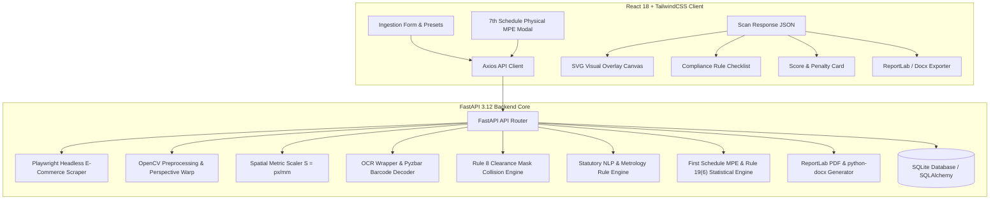

# MetroVerity — Inspector & User Operational Manual

## 1. Introduction & Overview

**MetroVerity** is a computer-vision-powered metrological compliance verification platform built for Legal Metrology Officers, Consumer Affairs Enforcement Authorities, and Quality Assurance Inspectors. It automates the inspection of packaged commodities under **The Legal Metrology Act, 2009** and **The Legal Metrology (Packaged Commodities) Rules, 2011 (LMPC Rules, 2011)**.

This manual provides step-by-step guidance on how to perform label inspections, verify physical dimensions and font heights, run statistical batch sampling against Maximum Permissible Error (MPE) thresholds, and issue statutory legal notices (Seventh Schedule Form A).

---

## 2. Authentication, Roles & Secrets

MetroVerity uses **Clerk** for robust, enterprise-grade authentication and JSON Web Token (JWT) identity management, and strictly enforces Role-Based Access Control (RBAC) across the FastAPI backend.

### Setting Up Authentication (Local Dev)
1. Register for a free Clerk account at clerk.com.
2. In the root `frontend/.env.local`, set your publishable key:
   `VITE_CLERK_PUBLISHABLE_KEY=pk_test_...`
3. In the root `backend/.env`, set your secret key:
   `CLERK_SECRET_KEY=sk_test_...`
4. **CRITICAL STEP:** In the Clerk Dashboard, navigate to **Configure > Sessions > Edit session token** and inject the following JSON:
   `{"public_metadata": "{{user.public_metadata}}"}`
   *(This ensures the backend receives the user's role in the JWT for RBAC enforcement).*

### Defining User Roles
The platform currently supports three strictly verified roles:
- **`ADMIN`**: Can run physical scans, e-commerce scrapes, MPE tests, view history, export reports, and strictly delete/clear inspection logs from the SQLite database.
- **`LMPC_OFFICER`**: Can run scans and view history, but cannot tamper with or delete logs.
- **`MANUFACTURER`**: Read-only profile for external transparency; can view historical logs and export reports, but cannot conduct enforcement scans.

**To assign a role:** Go to your Clerk Dashboard > Users > Select the user > Scroll down to Public Metadata and inject the JSON payload:
`{"role": "LMPC_OFFICER"}`

---

## 3. Dashboard Interface Tour

When you open MetroVerity (`http://localhost:5173`), the dashboard presents a clean, high-contrast, inspection-grade interface divided into key operational zones:

1. **Top Navigation Bar:**
   - **System Status Indicator:** Confirms that the backend rule engine and CV services are online.
   - **Physical MPE Test Button:** Opens the Fifth & First Schedule batch weight sampling modal.
   - **Inspection Log Button:** Opens the drawer containing previously scanned commodities archived in the SQLite database.
2. **Left Panel — Ingestion & Dimensions Form:**
   - Image upload / drag-and-drop zone.
   - Quick-load demo presets for instant one-click demonstration.
   - Precise physical package dimension inputs in millimeters ($H, W, D$).
   - Container geometry selector (Rectangular, Cylindrical, Irregular).
   - Commodity category dropdown (Biscuits, Tea, Soap, Edible Oil, General).
3. **Right Panel — Interactive Spatial Visual Overlay Canvas:**
   - Real-time rendering of package imagery.
   - Color-coded bounding box overlays (Green = PASS, Red = FAIL).
   - Rule 8(1) Net Quantity Clearance Zone buffer mask (dashed purple/red box).
   - Interactive zoom, pan, and hover measurement tooltips.
4. **Bottom Left Panel — Quantitative Scoring & Compounding Fee Card:**
   - 0–100% Quantitative score gauge.
   - Legal status badge (`COMPLIANT`, `PARTIALLY_COMPLIANT`, `NON_COMPLIANT`).
   - Assessed compounding fine in INR (₹) under Rule 32A.
   - Itemized list of statutory violations with legal severity rankings.
5. **Bottom Right Panel — Statutory Compliance Checklist:**
   - Visual Pass/Fail checklist covering Rules 6, 7, 8, 10, 12(6), 13, and Second Schedule.
6. **Export Panel:**
   - One-click buttons to export full PDF dossiers, Seventh Schedule Form A notices, editable DOCX reports, and raw CSV files.

---

## 4. Step-by-Step Inspection Workflow

### Step 1: Ingestion & Physical Dimension Calibration

To guarantee mathematically precise font height calculations, the system must calibrate pixels against real physical millimeters:

1. **Upload Label Image or Paste URL:**
   - **Physical Scan:** Click on the upload zone or drag and drop a `.jpg` or `.png` photograph of the product packaging.
   - **Digital E-Commerce Scan:** Click on the "E-Commerce Integration" tab and paste a valid Amazon or Flipkart URL to perform automated Rule 6(10) web crawling and cross-verification.
   - *Tip:* Alternatively, click any of the **Quick-Load Demo Presets** (e.g. *Britannia Biscuit*, *Fortune Oil Pouch*, *Herbal Shampoo*, or *Value Tea Pack*) to automatically load realistic sample packaging and dimensions.
2. **Enter Verified Dimensions (in mm):**
   - Measure the physical package height ($H$) in millimeters and enter it into the **Height (mm)** field.
   - Measure and enter the package width ($W$) in millimeters into the **Width (mm)** field.
   - Measure and enter the package depth ($D$) in millimeters (optional, used for irregular packages).
3. **Select Container Geometry [Rule 7(4)]:**
   - **Rectangular:** For cartons, pouches, and standard boxes where PDP Area $A = (H \times W) / 100 \text{ cm}^2$.
   - **Cylindrical:** For cans, bottles, and jars where PDP Area $A = 0.40 \times H \times (\pi \times W) / 100 \text{ cm}^2$.
   - **Irregular / Other:** For conical or uniquely shaped packages where PDP Area $A = 0.40 \times \text{Total Surface Area} / 100 \text{ cm}^2$.
4. **Select Commodity Category:**
   - Select the commodity type (e.g., Biscuits, Tea, Edible Oil, Soap, General) to verify compliance against Second Schedule standard pack sizes.
5. **Click "Run Automated Compliance Inspection"**:
   - The system initiates perspective rectification, OCR text extraction, metric scale computation, clearance collision checking, and rule evaluations.

---

### Step 2: Interpreting the Spatial Visual Canvas

Once processing completes, the **Spatial Visual Overlay Canvas** renders interactive annotations over the product image:

1. **Bounding Boxes:**
   - 🟢 **Green Bounding Box:** Indicates that the text element meets or exceeds the statutory minimum font height required for the calculated PDP surface area.
   - 🔴 **Red Bounding Box:** Indicates an under-sized font violation under Rule 7(2) Table-I.
2. **Interactive Tooltip Inspection:**
   - Click or hover over any bounding box to open the inspector card.
   - View:
     - **Extracted Text String**
     - **Measured Physical Font Height (mm)**
     - **Statutory Required Minimum Font Height (mm)**
     - **Rule Violation Reason (if non-compliant)**
3. **Rule 8(1) Clearance Buffer Zone:**
   - Toggle the **"Rule 8 Clearance Zone"** button in the canvas toolbar.
   - A dashed boundary appears around the Net Quantity declaration ($1\times h$ above/below, $1\times h$ left/right).
   - If other text elements (e.g. promotional slogans or graphic boxes) encroach inside this boundary, the clearance box turns **Red**, indicating a violation of Rule 8(1).
4. **Canvas Controls:**
   - Use the **Zoom In (+)**, **Zoom Out (-)**, and **Reset (↻)** buttons to inspect small micro-print or fine text.

---

### Step 3: Reviewing the Statutory Rule Checklist

The **Statutory Metrology Compliance Checklist** provides an exhaustive Pass/Fail breakdown across all relevant LMPC clauses:

| Statutory Rule | What is Checked | Pass Condition |
| :--- | :--- | :--- |
| **Rule 6(1)** | Mandatory Declarations | Manufacturer/Packer Name, Complete Address, Packing Date, Consumer Care contact present. |
| **Rule 6(1)(e)** | MRP Syntax & Tax Tag | Price declared with mandatory statutory phrase `"(incl. of all taxes)"` or `"(inclusive of all taxes)"`. |
| **Rule 7(2) Table-I** | Font Size vs. PDP Area | Numeral and letter heights $\ge$ statutory minimum threshold ($1.0\text{mm}$ to $6.0\text{mm}$) based on package area. |
| **Rule 8(1)** | Net Quantity Clearance | Minimum free space of $1\times h$ top/bottom and $1\times h$ left/right without encroaching text. |
| **Rule 10 & 6(1)(fa)** | PIN Code & Origin | Valid 6-digit Indian postal PIN code and Country of Origin declaration present. |
| **Rule 12(6)** | Deceptive Qualifiers | Absence of misleading terms like `"Approx"`, `"Approximate"`, `"Minimum"`, unauthorized `"When Packed"`. |
| **Rule 13** | SI Unit Standardization | Standard metric symbols used (e.g. capital `'L'` for Litre, `'g'`, `'kg'`, `'ml'`). |
| **Second Schedule** | Standard Pack Sizes | Nominal quantity matches Second Schedule standard SKUs (or is exempt as a ₹1–₹10 value pack). |
| **Rule 6(10) / 26(g)** | Digital Web Declarations | (E-Commerce) Webpage text must explicitly contain MRP, Net Qty, Mfg Name, and Consumer Care (contact/support/email). |
| **Cross-Verification** | Web vs. Physical | (E-Commerce) Digital web claims are checked against physical label OCR to detect deceptive discrepancies. |

---

### Step 4: Assessing Compounding Penalties & Scoring

The **Quantitative Scoring & Compounding Fee Card** summarizes the legal audit:
1. **0–100% Compliance Score:**
   - Starts at 100 and applies statutory deductions for each observed breach.
   - $\ge 90\%$: Statutorily Compliant
   - $50\% - 89\%$: Partially Compliant (Minor defects)
   - $< 50\%$: Non-Compliant (Critical statutory violations)
2. **Rule 32A Compounding Fine Assessment:**
   - **Section 29 (General declaration defaults):** ₹10,000 (Manufacturer) / ₹2,000 (Retailer)
   - **Section 36(1) (Non-standard pack size / font breaches / deceptive terms):** ₹25,000 (Manufacturer) / ₹5,000 (Retailer)
   - **Section 36(2) (Net quantity error exceeding MPE):** ₹50,000 (Manufacturer) / ₹10,000 (Retailer)
   - **Rule 18(2) (Selling above MRP):** ₹5,000 (Manufacturer) / ₹2,000 (Retailer)

---

### Step 5: Physical Weight Sampling & First Schedule MPE Verification

When physical warehouse or laboratory package weighing is conducted:

1. Click **"Physical MPE Test"** in the top navigation bar.
2. Enter the **Declared Nominal Quantity ($Q$)** and select units (`g` or `ml`).
3. Enter the **Tare Weight** of the packaging material.
4. Select the **Fifth Schedule Lot Size** (e.g., 32 units for standard inspection, 80 units for large lots).
5. Enter the measured gross weights in the interactive 32-cell grid (or click **"Passing Run"** / **"Failing Run"** for demonstration).
6. **Review the Three Statistical Verifications [Rule 19(6)]:**
   - **Verification 1 (Sample Mean $\bar{x}$):** The average net weight across all sample units must be $\ge$ the declared nominal quantity $Q$.
   - **Verification 2 (Defective Unit Allowance):** The number of individual packages with a deficiency greater than the First Schedule Table-I $\text{MPE}(Q)$ must not exceed the Fifth Schedule limit (maximum 2 allowed for a 32-unit lot).
   - **Verification 3 (Zero-Tolerance Limit):** No individual package may have a deficiency exceeding $2 \times \text{MPE}(Q)$.
7. **Generate Seventh Schedule Form A:**
   - If non-compliant, click **"Generate 7th Sched. Form A Notice (PDF)"** to download the formal statutory notice issued to the manufacturer/packer under Rules 27 & 28.

---

### Step 6: Multi-Format Report & Evidence Export

From the **Statutory Reports & Legal Notice Export** panel, click any of the 4 export buttons:

1. **Full PDF Dossier:** A formal, multi-page inspection report generated via ReportLab containing inspection metadata, declaration status tables, typography measurements, violation descriptions, fine assessments, SHA-256 evidence hash, and a digital certification block.
2. **7th Sched. Form A (PDF):** The official statutory notice under Rules 27 & 28 of LMPC Rules, 2011.
3. **Editable DOCX:** Microsoft Word document formatted for enforcement case files.
4. **Raw CSV Audit:** Structured CSV spreadsheet containing all raw data rows for integration with departmental ERP or statistical databases.

---

### Step 7: Inspection History Repository

1. Click **"Inspection Log"** in the top navbar.
2. The drawer displays past inspection records stored in the SQLite database.
3. Search by **Scan ID** (e.g., `MV-2026-XXXX`), **Category**, or **Compliance Status**.
4. Click any inspection card to instantly reload its image, bounding boxes, score, and findings onto the dashboard canvas.

---

## 4. Setup & Installation Instructions

MetroVerity uses **PaddleOCR** for robust text extraction and no longer requires Tesseract. Follow the instructions for your operating system below.

### 4.1 Windows Setup (Priority)

**Prerequisites:**
- **Git**
- **Node.js** (v18 or higher) & **npm**
- **Python 3.10** (Download from Python.org. **IMPORTANT:** During installation, check the box "Add Python 3.10 to PATH").
- **Microsoft Visual C++ Redistributable** (Required for PaddleOCR C++ binaries on Windows).

**1. Clone the Repository:**
```cmd
git clone https://github.com/yourusername/Heisen-De-Buggers.git
cd Heisen-De-Buggers
```

**2. Backend Setup:**
Open Command Prompt or PowerShell and run:
```cmd
cd backend
python -m venv .venv
.venv\Scripts\activate
pip install -r requirements.txt
uvicorn app.main:app --host 0.0.0.0 --port 8000 --reload
```
*(The backend API will be available at `http://localhost:8000`)*

**3. Frontend Setup:**
Open a *new* Command Prompt or PowerShell window and run:
```cmd
cd Heisen-De-Buggers\frontend
npm install
npm run dev
```
*(Open your web browser and navigate to `http://localhost:5173`)*

---

### 4.2 Linux / macOS Setup

**Prerequisites:**
- **Git**
- **Node.js** (v18 or higher) & **npm**
- **Python 3.10**

**1. Clone the Repository:**
```bash
git clone https://github.com/yourusername/Heisen-De-Buggers.git
cd Heisen-De-Buggers
```

**2. Backend Setup:**
```bash
cd backend
python3.10 -m venv .venv
source .venv/bin/activate
pip install -r requirements.txt
uvicorn app.main:app --host 0.0.0.0 --port 8000 --reload
```

**3. Frontend Setup:**
Open a *new* terminal window and run:
```bash
cd frontend
npm install
npm run dev
```

### 4.3 Usage
Once both the backend and frontend servers are running, you can interact with the MetroVerity dashboard, upload product images, and run statutory compliance inspections locally.


## Resetting Inspection History
If you wish to completely wipe the current inspection history and start fresh, the system provides a cross-platform utility script. 
Open your terminal in the root directory of the project and run:
```bash
python scripts/clear_history.py
```
This will instantly clear the database records and purge the uploaded imagery. Refresh your browser to see the empty inspection log.


## Troubleshooting

### Windows: "Vision Engine Offline" or Silent Scan Failures
If you are running the backend on a Windows machine and the scan process instantly fails with a "Vision Engine Offline" error (or if the application silently generates a completely empty report with zero bounding boxes), this indicates the PaddleOCR engine failed to compile.

**Root Cause:**
PaddleOCR relies on deep learning C++ binaries that require native Windows compilation libraries to run.

**Solution:**
1. Download and install the [Microsoft Visual C++ Redistributable 2015-2022 (x64)](https://learn.microsoft.com/en-US/cpp/windows/latest-supported-vc-redist?view=msvc-170).
2. Reboot your computer.
3. Restart the FastAPI backend server.


# MetroVerity — Developer Architecture & Contribution Guide

## 1. System Architecture & High-Level Design

MetroVerity is engineered as a decoupled, high-performance web platform combining a **FastAPI backend** (running computer vision, metrological math, and statutory rule evaluation) with a **React 18 (Vite + TailwindCSS) frontend** (providing responsive canvas visualizations, dynamic rule checklists, and live physical sampling test benches).



---

## 2. Metrological Mathematical Foundations & Formulations

### A. Principal Display Panel (PDP) Surface Area ($A$) [Rule 7(4)]
The surface area $A$ in $\text{cm}^2$ determines the required font height:
- **Rectangular Container [Rule 7(4)(a)]:**
  $$A = \frac{\text{Height (mm)} \times \text{Width (mm)}}{100}$$
- **Cylindrical / Nearly Cylindrical Container [Rule 7(4)(b)]:**
  $$A = \frac{0.40 \times \text{Height (mm)} \times (\pi \times \text{Diameter (mm)})}{100}$$
- **Irregular / Other Shaped Container [Rule 7(4)(c)]:**
  $$A = \frac{0.40 \times \text{Total Surface Area (mm}^2)}{100} \approx \frac{0.40 \times 2(HW + WD + HD)}{100}$$

Implemented in: [`backend/app/vision/spatial_scaler.py`](file:///home/binaryraptor/Projects/Heisen-De-Buggers/backend/app/vision/spatial_scaler.py#L6-L45)

---

### B. Metric Scale Ratio & Physical Font Height Conversion
$$\text{Scale Ratio } S_{\text{px/mm}} = \frac{\text{Package Height in Image (pixels)}}{\text{User-Input Verified Package Height (mm)}}$$
$$\text{Actual Feature Size (mm)} = \frac{\text{Feature Bounding Box Dimension (pixels)}}{S_{\text{px/mm}}}$$

Implemented in: [`backend/app/vision/spatial_scaler.py`](file:///home/binaryraptor/Projects/Heisen-De-Buggers/backend/app/vision/spatial_scaler.py#L62-L80)

---

### C. Statutory Minimum Font Height Thresholds [Rule 7(2), Table-I]
| Calculated PDP Area ($A$) in $\text{cm}^2$ | Minimum Font Height (Normal Print) | Minimum Font Height (Blown/Molded) |
| :--- | :--- | :--- |
| $A \le 50$ | $1.0\text{ mm}$ | $1.5\text{ mm}$ |
| $50 < A \le 100$ | $1.5\text{ mm}$ | $3.0\text{ mm}$ |
| $100 < A \le 500$ | $2.5\text{ mm}$ | $4.0\text{ mm}$ |
| $500 < A \le 2500$ | $4.0\text{ mm}$ | $6.0\text{ mm}$ |
| $A > 2500$ | $6.0\text{ mm}$ | $6.0\text{ mm}$ |

Implemented in: [`backend/app/vision/spatial_scaler.py`](file:///home/binaryraptor/Projects/Heisen-De-Buggers/backend/app/vision/spatial_scaler.py#L47-L60)

---

### D. Net Quantity Clearance Buffer Geometry [Rule 8(1)]
Given the bounding box of the Net Quantity declaration $[x, y, w, h]$:
- **Vertical Clearance (Top/Bottom):** Free space $\ge 1.0 \times h$
- **Horizontal Clearance (Left/Right):** Free space $\ge 1.0 \times h$ (Reduced from 2.0x for visual clarity)
- **Clearance Polygon Boundary:**
  $$\text{Clearance Bounding Box} = [x - h, \; y - h, \; w + 2h, \; h + 2h]$$
- **Collision Condition:** Evaluated via Axis-Aligned Bounding Box (AABB) intersection against all other text tokens on the surface.

Implemented in: [`backend/app/vision/clearance_mask.py`](file:///home/binaryraptor/Projects/Heisen-De-Buggers/backend/app/vision/clearance_mask.py#L4-L78)

---

### E. Maximum Permissible Error (MPE) [First Schedule, Table-I]
For a declared nominal quantity $Q$ (in grams or milliliters):

$$\text{MPE}(Q) = \begin{cases}
9\% \text{ of } Q & Q \le 50\text{ g/ml} \\
4.5\text{ g/ml} & 50 < Q \le 100\text{ g/ml} \\
4.5\% \text{ of } Q & 100 < Q \le 200\text{ g/ml} \\
9.0\text{ g/ml} & 200 < Q \le 300\text{ g/ml} \\
3\% \text{ of } Q & 300 < Q \le 500\text{ g/ml} \\
15.0\text{ g/ml} & 500 < Q \le 1000\text{ g/ml} \\
1.5\% \text{ of } Q & 1000 < Q \le 10000\text{ g/ml} \\
150.0\text{ g/ml} & 10000 < Q \le 15000\text{ g/ml} \\
1.0\% \text{ of } Q & Q > 15000\text{ g/ml}
\end{cases}$$

**Statistical Batch Conditions [Rule 19(6)]:**
1. Sample Mean $\bar{x} \ge Q$.
2. Number of defective packages with error $> \text{MPE}(Q)$ must be $\le$ Fifth Schedule limits ($\le 2$ for lot size 32; $\le 5$ for lot size 80).
3. **Zero Tolerance:** No individual package deficiency may exceed $2 \times \text{MPE}(Q)$.

Implemented in: [`backend/app/api/physical_test.py`](file:///home/binaryraptor/Projects/Heisen-De-Buggers/backend/app/api/physical_test.py#L8-L38)

---

### F. Quantitative Compliance Scoring & Penalty Assessment
The compliance score begins at 100 and applies weighted statutory deductions:

```python
# 1. Mandatory Declarations (Rule 6, 10): -15 per missing mandatory parameter
# 2. MRP Integrity (Rule 6(1)(e)): -25 if missing MRP, -15 if missing tax tag
# 3. Typography & Clearance (Rule 7 & 8): -20 if under-sized font, -15 if clearance encroachment
# 4. Deceptive Marketing Terms (Rule 12(6)): -25 if deceptive qualifier found
# 5. SI Units Standardization (Rule 13): -10 if non-standard units found
# 6. Second Schedule Pack Size: -15 if non-standard size and not exempt
```

Implemented in: [`backend/app/core/rules_engine.py`](file:///home/binaryraptor/Projects/Heisen-De-Buggers/backend/app/core/rules_engine.py#L295-L330)

---

## 3. Backend Module Breakdown

### 1. `app/vision/scraper.py` (E-Commerce Module)
- `scrape_ecommerce_listing(url)`: Uses headless Playwright to navigate to e-commerce URLs, bypasses basic anti-bot with custom user agents, and executes dynamic JavaScript scrolls to trigger lazy-loaded product galleries.
- `High-Res Regex Engine`: Intercepts `` URLs and strips thumbnail modifiers (e.g., removing Amazon's `._AC_UL320_` or replacing Flipkart's `/300/300/` with `/1000/1000/`) to download pristine, high-resolution source images for OCR.
- Extracts `document.body.innerText` for digital text evaluation under Rule 6(10).

### 2. `app/vision/preprocessor.py`
- `load_image_with_exif(image_path)`: Reads images using PIL + OpenCV, automatically correcting orientation based on EXIF tags.
- `four_point_transform(image, pts)`: Computes perspective transform matrix and rectifies tilted labels.
- `auto_rectify_label(image)`: Canny edge and contour detection to identify 4-point quadrilateral label boundaries.
- `calculate_contrast_ratio(bgr_crop)`: Text-to-background luminance ratio estimation.

### 3. `app/vision/ocr_wrapper.py`
- `decode_barcodes(image_bgr)`: Uses `pyzbar` to decode 1D/2D barcodes (EAN-13, UPC-A, Code128, QR) and validates GTIN length.
- `extract_text_regions_cv(image_bgr)`: Morphological gradient and Otsu thresholding to extract candidate text bounding boxes.
- `run_ocr(image_bgr, scale_factor, required_font_height_mm, is_metallic_surface)`: Uses **PaddleOCR** to extract text tokens. Features an automatic downscaling pipeline (`max_dim=600px`) for metallic surfaces to fuse disconnected dot-matrix text on high-res images, before inversely scaling bounding boxes.

### 4. `app/core/rules_engine.py`
- `extract_pin_code(text)`: Regex matching 6-digit Indian PIN codes (`\b[1-9][0-9]{5}\b`).
- `extract_country_of_origin(text)`: Identifies origin declarations (`Made in India`, `Country of Origin: ...`).
- `extract_mfg_date(text)`: Parses date of packing/manufacturing formats (`MM/YYYY`, `Month YYYY`, `PKD DD/MM/YY`).
- `extract_consumer_care(text)`: Parses toll-free numbers (`1800...`), helpline numbers, support emails, and keywords like `contact`, `support`, `grievance`.
- `extract_mrp(text)`: Extracts declared price and checks for mandatory `"(incl. of all taxes)"` or `"(inclusive of all taxes)"` phrase.
- `extract_net_quantity(text)`: Extracts declared numeric quantity and unit.
- `evaluate_statutory_compliance(...)`: End-to-end evaluation pipeline assembling the checklist, compounding penalties, and score for physical scans.
- `evaluate_ecommerce_cross_verification(...)`: Evaluates e-commerce web text under Rule 6(10) / Rule 26(g) and performs digital vs. physical text cross-verification.

### 5. `app/api/physical_test.py`
- `POST /api/v1/test/mpe-check`: Evaluates batch weights against First Schedule MPE piecewise limits, sample mean, Fifth Schedule defective allowances, and zero-tolerance conditions.

### 6. `app/api/report.py`
- `POST /api/v1/report/export`: Generates downloadable documents:
  - `export_type="pdf"`: Complete Inspection Dossier via ReportLab with SHA-256 evidence hash.
  - `export_type="seventh_schedule_form_a"`: Official statutory notice to manufacturer/packer under Rules 27 & 28.
  - `export_type="docx"`: Editable Word document via `python-docx`.
  - `export_type="csv"`: Tabular CSV audit data.

### 7. `app/storage/`
- `models.py`: SQLAlchemy `ScanRecord` model storing scan metadata, measurements, image filename, and full JSON payload.
- `database.py`: Synchronous and asynchronous SQLite session factories.

---

## 4. Frontend Architecture & Canvas Rendering

### Component Structure
```text
frontend/src/
├── components/
│   ├── Navbar.jsx               # Top header, branding, navigation triggers
│   ├── IngestionForm.jsx        # File upload, dimensions (H, W, D), presets
│   ├── VisualOverlay.jsx        # SVG canvas with color-coded bounding boxes & clearance mask
│   ├── ComplianceChecklist.jsx  # Pass/Fail cards for Rules 6, 7, 8, 10, 12, 13, 2nd Sched
│   ├── ComplianceCard.jsx       # 0-100% Score gauge, fine estimate, violation details
│   ├── SeventhScheduleModal.jsx # Weight table, live MPE calculation, Form A download
│   ├── ExportPanel.jsx          # Download triggers (PDF, Form A, DOCX, CSV)
│   └── HistoryDrawer.jsx        # Searchable SQLite scan log drawer
├── services/
│   └── api.js                   # Axios HTTP client connecting to FastAPI
├── App.jsx                      # Root workflow coordinator
└── index.css                    # Tailwind CSS configuration
```

### SVG Overlay Coordinate Mapping
In [`VisualOverlay.jsx`](file:///home/binaryraptor/Projects/Heisen-De-Buggers/frontend/src/components/VisualOverlay.jsx), the SVG overlay layer uses `viewBox="0 0 {origW} {origH}"` with `preserveAspectRatio="none"` over the responsive image. This ensures bounding box coordinates $[x, y, w, h]$ scale 1:1 with the rendered packaging photo regardless of screen size or zoom level.

---

## 5. API Data Contracts

### 1. `POST /api/v1/audit/scan`
**Request (multipart/form-data):**
- `url`: string (optional, for e-commerce scraping)
- `files`: Array of image files (`.jpg`, `.png`) for multi-surface scanning (if `url` is not provided)
- `package_height_mm`: float (e.g. `150.0`)
- `package_width_mm`: float (e.g. `80.0`)
- `package_depth_mm`: float (optional, e.g. `30.0`)
- `container_type`: string (`"rectangular"` | `"cylindrical"` | `"irregular"`)
- `category`: string (`"biscuits"` | `"tea"` | `"soap"` | `"edible_oil"` | `"general"`)

**Response (application/json):**
```json
{
  "scan_id": "MV-2026-A1B2C3",
  "timestamp": "2026-08-29T18:15:00Z",
  "package_height_mm": 150.0,
  "package_width_mm": 80.0,
  "container_type": "rectangular",
  "category": "biscuits",
  "pdp_area_cm2": 120.0,
  "required_font_height_mm": 2.5,
  "compliance_score": 95,
  "status": "COMPLIANT",
  "estimated_compounding_fine_inr": 0,
  "rule_checklist": {
    "rule_6_mandatory_fields": true,
    "rule_6_1_e_mrp_syntax": true,
    "rule_7_font_height": true,
    "rule_8_clearance": true,
    "rule_10_origin_pin": true,
    "rule_12_deceptive_terms": true,
    "rule_13_si_units": true,
    "second_schedule_pack_size": true
  },
  "declarations": { ... },
  "net_quantity": { ... },
  "mrp": { ... },
  "deceptive_terms": { ... },
  "violations": [ ... ],
  "surfaces": [
    {
      "surface_id": 0,
      "image_filename": "front.jpg",
      "pdp_area_cm2": 120.0,
      "bounding_boxes": [ ... ],
      "barcodes": [ ... ],
      "clearance_zone": { ... }
    }
  ]
}
```

---

## 6. Automated Testing & Verification

The test suite covers all metrological mathematical formulas, statutory regex parsing, physical MPE calculations, and REST API endpoints:

```bash
# Run pytest test suite
PYTHONPATH=backend backend/.venv/bin/pytest backend/tests -v
```

### Test Modules:
1. `backend/tests/test_scaler.py`: Tests PDP area formulas for rectangular, cylindrical, and irregular packages; Rule 7 Table-I font height ladders; scale factor computation; and Rule 7(3) character aspect ratios.
2. `backend/tests/test_rules.py`: Tests PIN code extraction, origin parsing, packing date detection, consumer care regex, MRP syntax verification, deceptive term classification, and scoring deduction calculations.
3. `backend/tests/test_mpe.py`: Tests First Schedule Table-I piecewise formula across all 9 quantity tiers, Fifth Schedule defective allowances, and zero-tolerance violations.
4. `backend/tests/test_api.py`: Integration tests for `/scan`, `/mpe-check`, and multi-format `/export` endpoints (PDF, DOCX, CSV).

---

## 7. How to Add a New Statutory Rule

To introduce a new Legal Metrology compliance rule to MetroVerity:

1. **Define Schema Property:** Update `RuleChecklist` in [`backend/app/models/schemas.py`](file:///home/binaryraptor/Projects/Heisen-De-Buggers/backend/app/models/schemas.py).
2. **Implement Rule Logic:** Add the regex or geometric validator in [`backend/app/core/rules_engine.py`](file:///home/binaryraptor/Projects/Heisen-De-Buggers/backend/app/core/rules_engine.py).
3. **Add Compounding Section & Penalty:** Register applicable penalty amounts under Rule 32A.
4. **Update Scoring Weights:** Adjust deduction points in `compute_compliance_score`.
5. **Add Frontend Checklist Card:** Include the rule title, description, and status in [`frontend/src/components/ComplianceChecklist.jsx`](file:///home/binaryraptor/Projects/Heisen-De-Buggers/frontend/src/components/ComplianceChecklist.jsx).
6. **Add Unit Tests:** Write corresponding test cases in `backend/tests/test_rules.py`.


## Utility Scripts
### `clear_history.py`
Located in `scripts/clear_history.py`, this Python script provides a cross-platform method for truncating the SQLite `scan_records` table and wiping the `backend/uploads/` directory. Use this during testing to quickly reset the application state without needing to manually recreate the database schema or restart the uvicorn server.
